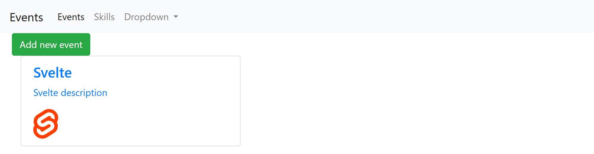
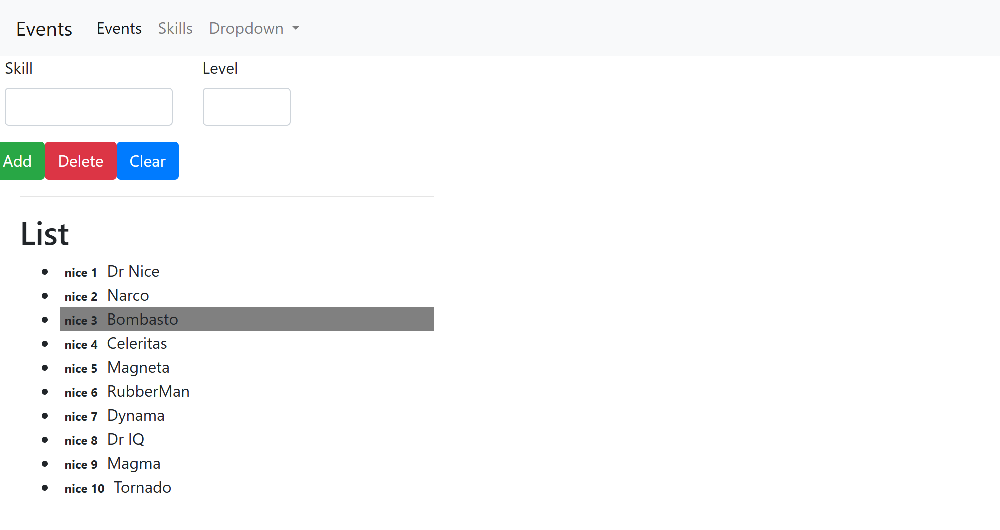

# EventScheduler — Angular 8 learning project (2019)

**[▶ Live demo](https://dimitriuses.github.io/Angular-List/)**

[](https://github.com/Dimitriuses/Angular-List/actions/workflows/pages.yml)


[](LICENSE)

My first Angular project: two panels behind a navbar tab switch — an event list and a
skills list — written while working through the Angular CLI and Tour of Heroes tutorials in
October 2019. It renders, it switches tabs, and it selects rows. Nothing in it saves,
loads or adds anything: every form control on screen is a facade.

It is kept here as a record of where I started with front-end work, tidied and given a
live demo, but not rebuilt. The 2019 code is preserved at the
[`v0.1-original`](../../tree/v0.1-original) tag.





## Status and history

Two commits of actual work, both in October 2019:

| When | Commit | What |
|---|---|---|
| 2019-10-15 11:36 | `d69378b` *add list show* | The whole CLI scaffold, the skills panel and the events panel |
| 2019-10-16 12:01 | `680f96a` *add toggle tabs* | The navbar tab switch — 19 insertions across 5 files |

The remaining 20 of the 22 commits are Dependabot: ten bumps of transitive versions in
`package-lock.json` between 2020 and 2021, and the ten merge commits that landed them. So
this is roughly one afternoon and one follow-up morning of work, and the repository has had
no feature work since.

**It still runs.** The whole thing installs, lints, builds *and* serves on Node 22 with one
environment variable and no source changes — see *Running it locally* below. That was worth
checking rather than assuming: Angular 8.2 already used dart-sass rather than node-sass, so
there is no native compilation step to fail, which is why this survived where most 2019
front-ends do not.

I can't prove it ran in October 2019, but the second commit adjusts the markup the first one
produced, which is not something you do without looking at the page.

## What it actually does

- **Events tab** — one hardcoded event ("Svelte"), rendered from an array literal. The
  *Add new event* button has no handler.
- **Skills tab** — ten skills from a mock array. Clicking a row highlights it grey. The
  *Skill* / *Level* inputs are unbound, and *Add*, *Delete* and *Clear* do nothing (see
  below for what *Add* does instead).
- **Navbar** — switches between the two panels by setting a string on `AppComponent` and
  toggling `*ngIf`.

The mock skill data is still the Tour of Heroes cast (`Dr Nice`, `Narco`, `Bombasto`…)
with levels `nice 1`…`nice 10`. I left it as it was; substituting plausible-looking skill
names would hide where the code came from.

## Running it locally

Requires **Node 22** (`.nvmrc`) and the OpenSSL legacy provider, because webpack 4 hashes
with md4 and OpenSSL 3 refuses to supply it:

```bash
nvm use                                   # Node 22
npm ci                                    # 1,193 packages
NODE_OPTIONS=--openssl-legacy-provider npm start
# then open http://localhost:4200/
```

On Windows PowerShell, `$env:NODE_OPTIONS = '--openssl-legacy-provider'` before `npm start`.

Production build, as the Pages workflow does it:

```bash
NODE_OPTIONS=--openssl-legacy-provider npx ng build --prod --base-href /Angular-List/
```

`.npmrc` pins `legacy-peer-deps=true`: npm 7+ resolves Bootstrap 4's `jquery` and
`popper.js` peer dependencies strictly, the 2019 npm-6 lockfile never recorded them, and
this app loads only Bootstrap's CSS — never its JavaScript.

## Tests

There are three, they are the untouched Angular CLI defaults, and **all three fail**:

```
HeadlessChrome 150.0.0 (Windows 10.0.0): Executed 3 of 3 (3 FAILED)
'app-header' is not a known element:
'app-events' is not a known element:
'app-skills-list' is not a known element:
```

The CLI's default `app.component.html` had already been replaced with markup that
instantiates three child components *before anything was committed*, while
`app.component.spec.ts` was left exactly as generated, declaring only `AppComponent` in its
`TestBed`. So the template cannot be parsed and every test in the file dies with it. The
third test also asserts that `.content span` contains `'eventScheduler app is running!'` —
markup that has never existed in any committed version of this project.

**They were failing on 2019-10-15 and they are failing now.** `e2e/src/app.e2e-spec.ts`
carries the identical stale assertion. I have left them failing
rather than quietly repairing them, because "the tests never ran" is the honest fact about
this repository, and the CI workflow builds and deploys without pretending otherwise.

`npm run lint` does pass — that part was fixed, see below.

## What changed in 2026

A tidy, not a rewrite. **No behaviour was changed**, and that is measured rather than
asserted: a Playwright harness drives a nine-checkpoint session (both panels, two row
selections, the no-op buttons, a phone viewport, the hamburger, and the *Add* button) and
records the rendered text, computed colours, geometry, images and loaded bundles of every
element under `app-root`, plus a screenshot hash. It was run three times against the 2019
build first — 9/9 identical each time — before any comparison was trusted.

Against the final build, **the four Skills-panel checkpoints are byte-identical to the 2019
build**, DOM dump *and* PNG. The five Events-panel checkpoints differ, and the difference is
fully accounted for by the two intentional changes below:

- the five deleted DOM nodes, plus the 39 px of vertical space they occupied;
- the image swap — four lines, being the `src`, the intrinsic size, and the ``/`<span>`
  boxes going from 50×50 to 41.6×50 (the replacement is the logo mark, where the 2019 hotlink
  was the same mark padded square). Same position, same colours, same everything else; the
  brand colour was pixel-sampled at `#FF3E00` in both.

Nothing else moved.

- **Removed two CLI stub components** that shipped their scaffolding text into the running
  UI: `events-detail` rendered `events-detail works!` in the right-hand column, and
  `events-item` rendered `events-item works!` under the list. Both were `ng generate`
  output that never got an implementation. The empty column went with them.
- **Fixed the misspelled domain type.** `sckill.ts` → `skill.ts`, `mock_sckills.ts` →
  `mock-skills.ts`, `Sckill` → `Skill`, `SCKILL` → `SKILLS`, `selectSckill` →
  `selectedSkill`. Other awkward names (`LChose`, `onChoseSwitch`, a parameter called
  `P1`) are left exactly as written — this was a spelling fix, not a restyling.
- **Deleted 11 lines of commented-out code**: a Tour of Heroes detail pane, still
  referencing the tutorial's `selectedHero`, which does not exist in this project.
- **Dropped two unused dependencies**, `@angular/animations` and `@angular/forms`, neither
  imported anywhere. Verified as a surgical change: the regenerated lockfile resolves
  **916 packages against the original 918, with zero additions and zero version changes**.
- **`npm run lint`: 46 errors → 0.** All formatting (quote style, semicolons, whitespace,
  a 141-character line against a 140 limit — the image URL, now a named constant).
  tslint and Protractor are both end-of-life; they are period-typical
  and were deliberately left in place rather than swapped for a modern toolchain.
- **Replaced the hotlinked image with a local, properly licensed one.** The only picture in
  the app was pulled straight off egghead.io's CDN in 2019, so the demo depended on a third
  party's bandwidth. It is now `src/assets/svelte-logo.svg` — the Svelte logo by Rich Harris,
  from Wikimedia Commons under the **MIT licence**, unmodified, attributed, and checksummed.
  Svelte's own branding repository was the obvious source and could not be used: it has no
  licence at all. Full provenance and the trademark reasoning are in
  [docs/ASSETS.md](docs/ASSETS.md). **The site is now entirely self-contained** — the
  production build makes zero third-party requests.
- Added the Pages workflow, `.nvmrc`, `.npmrc`, this README, `LICENSE` and `docs/`.

## Known limitations

Everything here is measured on the current build, not guessed at.

- **The *Add* button reloads the page and loses your place.** It is `type="submit"` inside
  a `<form>` with no `action`, no `(ngSubmit)` and no `FormsModule`, so the browser
  performs a native `GET .../?` — a full page load. Because `AppComponent` initialises its
  panel to `'events'`, you land back on the *other* tab. The fingerprint makes this exact:
  the state after clicking *Add* is **byte-identical to a cold page load**. The inputs also
  have no `name` attribute, so the request does not even carry what you typed.
- **The app is half-unusable on a phone.** Bootstrap's JavaScript is never loaded —
  `angular.json` lists `bootstrap.min.css` under `styles` and nothing under `scripts`, and
  `window.jQuery` / `window.bootstrap` are both `undefined` at runtime. The breakpoint was
  measured: at 992 px the nav bar is open and *Skills* is clickable; at **991 px and below**
  it collapses behind a hamburger that cannot open it (`.navbar-collapse` at 0 px and
  `display: none` before *and* after the click, class unchanged), and both tab links live
  inside it. So
  **on a phone there is no way to reach the Skills panel at all.** The navbar *Dropdown*
  is dead on every viewport for the same reason (`display: none` after a click).
- **Nothing persists and nothing can be created.** `Delete` and `Clear` are handler-less
  (measured: the list stays at 10 items), the two text inputs are bound to nothing, and
  `SkillsEditComponent` is an empty stub. There is no service layer, no HTTP, no storage.
- **The router is imported and unused.** `AppRoutingModule` calls `RouterModule.forRoot([])`
  with zero routes; navigation is a string field plus `*ngIf`. There are no deep links, and
  the Back button does not restore the previous tab — the `href="#"` nav links do not call
  `preventDefault`, so clicking a tab only pushes a `#` history entry.
- **The two panels have nothing to do with each other.** An event scheduler does not need
  a skills list; that panel exists because it was the tutorial chapter I was on.
- `Event` in `src/app/events/event.ts` is a default export named `Event`, which shadows the
  DOM's global `Event` type inside every module that imports it.
- **`npm audit` reports 133 advisories** (29 critical, 63 high, 30 moderate, 11 low) — but
  `npm audit --omit=dev` reports **3**, all in Angular 8's own `common` / `compiler` / `core`
  packages. So 130 of the 133 are in the build-time dev dependencies of a 2019 toolchain and
  never reach a browser. Fixing the three means leaving Angular 8, which is a rebuild rather
  than a tidy.

## Layout

```
src/app/
  app.component.*            tab switch (a string field and two *ngIf)
  app-routing.module.ts      RouterModule.forRoot([]) — zero routes
  header/                    Bootstrap navbar, emits the selected tab
  events/
    event.ts                 title / description / imgPath
    events.component.*       row wrapper
    events-list/             the one hardcoded event
  skills-list/
    skills-list.component.*  the ten mock skills, click to select
    skills-edit/             the form that does nothing
  skill.ts, mock-skills.ts   the model and its mock data
```

## Licence

MIT — see [LICENSE](LICENSE).

The one image, `src/assets/svelte-logo.svg`, is the Svelte logo by **Rich Harris**, used under
the **MIT licence** via [Wikimedia Commons](https://commons.wikimedia.org/wiki/File:Svelte_Logo.svg)
and included unmodified. The Svelte name and logo are trademarks of the Svelte project; their
use here is descriptive, and this project is not sponsored or endorsed by it. See
[docs/ASSETS.md](docs/ASSETS.md).
